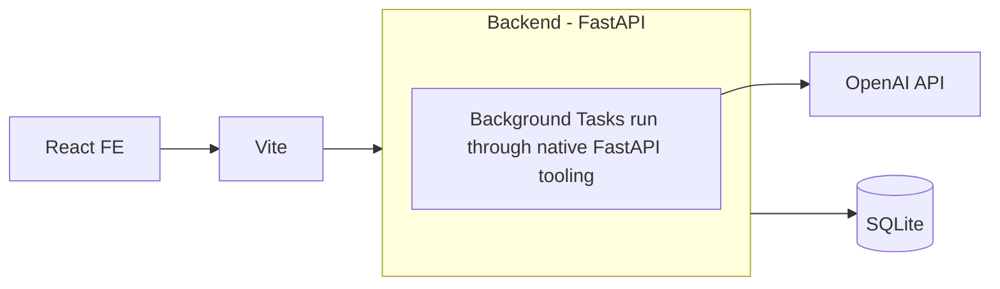

# Fullstack Submission


## How to Run
Setup:
- Meant to be run with `docker compose`.
- Your environment should have the value `OPENAI_API_KEY` set.

```sh
make up     # build and start -- this will tail the logs of the app
make down   # stop
make clean  # stop and delete the SQLite volume

# separately, optional
make test   # backend (pytest) + frontend (jest); also test-be / test-fe
```

- Frontend (Vite): http://localhost:5173
- Backend (FastAPI): http://localhost:8000 (docs at `/docs`)
- Vite proxies `/api/*` to the backend


## What's here 

### Architecture


### Key Models
The following is a pydantic representation of the key models
in this application, namely: `IntakeSubmission` and `IntakeSubmissionTriageRecord`. 

The following code is illustrative and intentionally incomplete:
```python
from typing import Optional, List
from uuid import UUID
from enum import StrEnum
from pydantic import BaseModel, Field
from datetime import datetime 

class Naics2dIndustryCode(StrEnum):
  pass

class BaseUUIDCreateModel(BaseModel):
  id: UUID 
  created_at: datetime
  updated_at: datetime

class IntakeSubmission(BaseUUIDCreateModel):
    """
    An intake of a new initiative that tribe will be undertaking
    """
    title: str = Field(description="Name or title of the project")
    description: str = Field(description="brief overview of project and goals")
    start_datetime: datetime 
    end_datetime: datetime
    industry: Naics2dIndustryCode
    budget_range: str 

class IntakeSubmissionTriageRecord(BaseUUIDCreateModel):
    """
    This is where we store the results of our intake scoring of our individual
    submissions
    """
    intake_submission_id: UUID # linking to our orig submission
    summary: str = Field(description="A summary of the project generated by our LLM triager")
    tags: Optional[List[str]] = Field(default="a list of tags that will help us filter/search")
    risk_checklist: str = Field(description="A set of bullet points that will describe the risks associated with this initiave")


```


## Verification
- Verification performed with unit tests and manual QA.
- No integration tests were introduced.

## To Do
- [X] End-to-end functioning app
- [X] 3 views of: 
  - [X] List, 
  - [X] Item, 
  - [X] Create
- [X] LLM Triager
  - [X] Task/Async framework
  - [X] Frontend polling mechanism to retrieve the task result
  - [X] any llm interaction
- [X] A little bit of styling so it doesn't look hideous
- [X] UX States
  - [X] Loading
  - [X] Empty
  - [X] Error - if openai response is in error or if the response from the Backend

- [X] containerize
- [X] tests for both FE, BE
- [X] Typescript

- [X] Walkthrough at the end